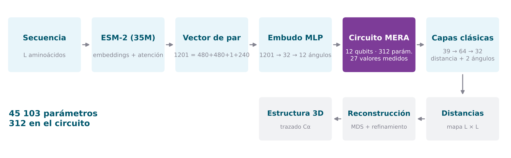
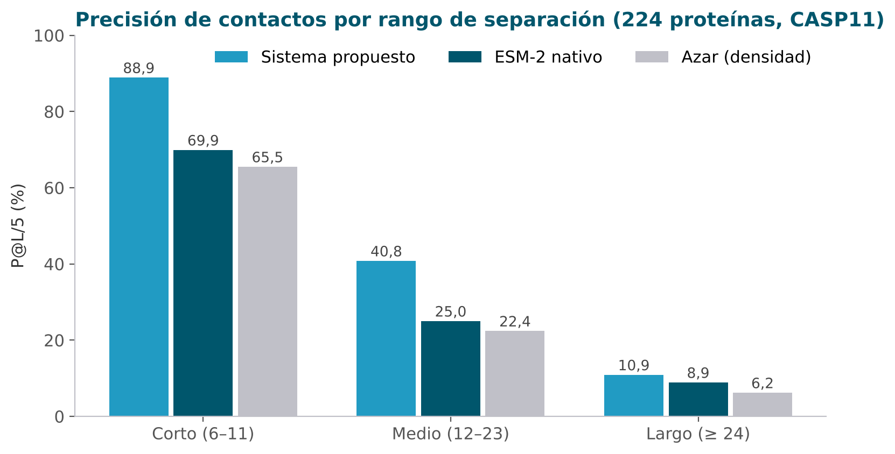
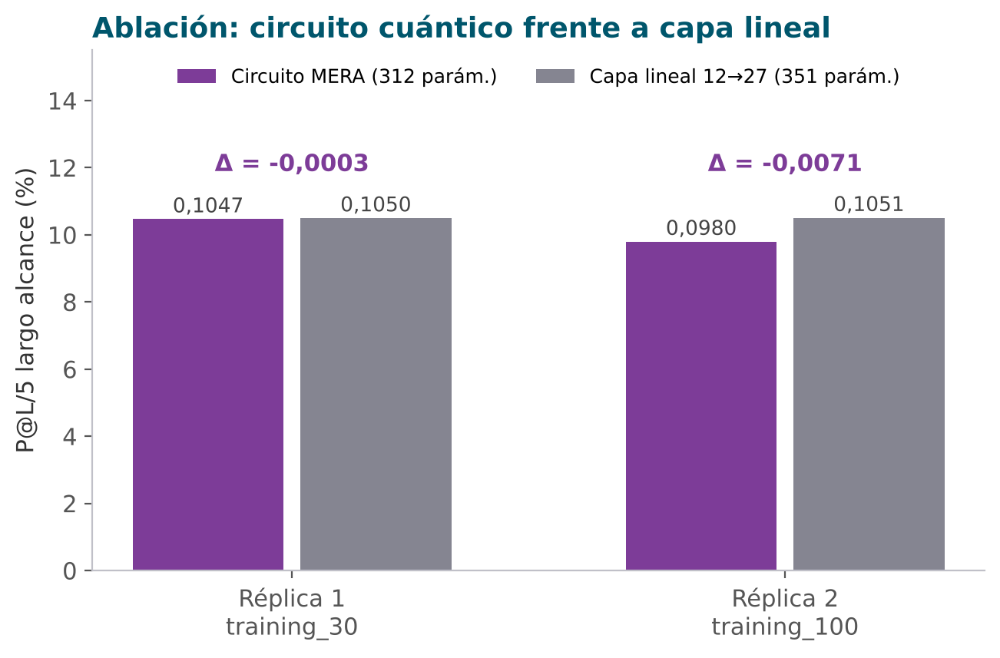
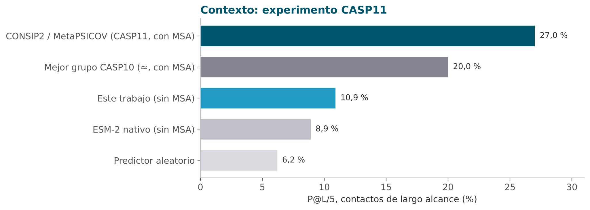
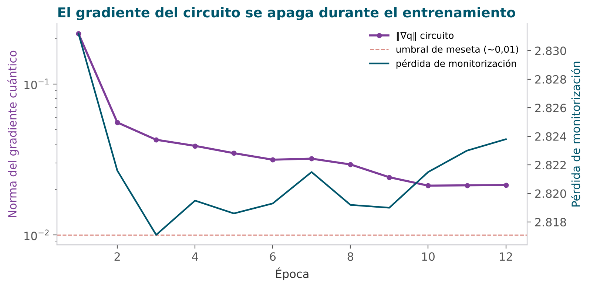
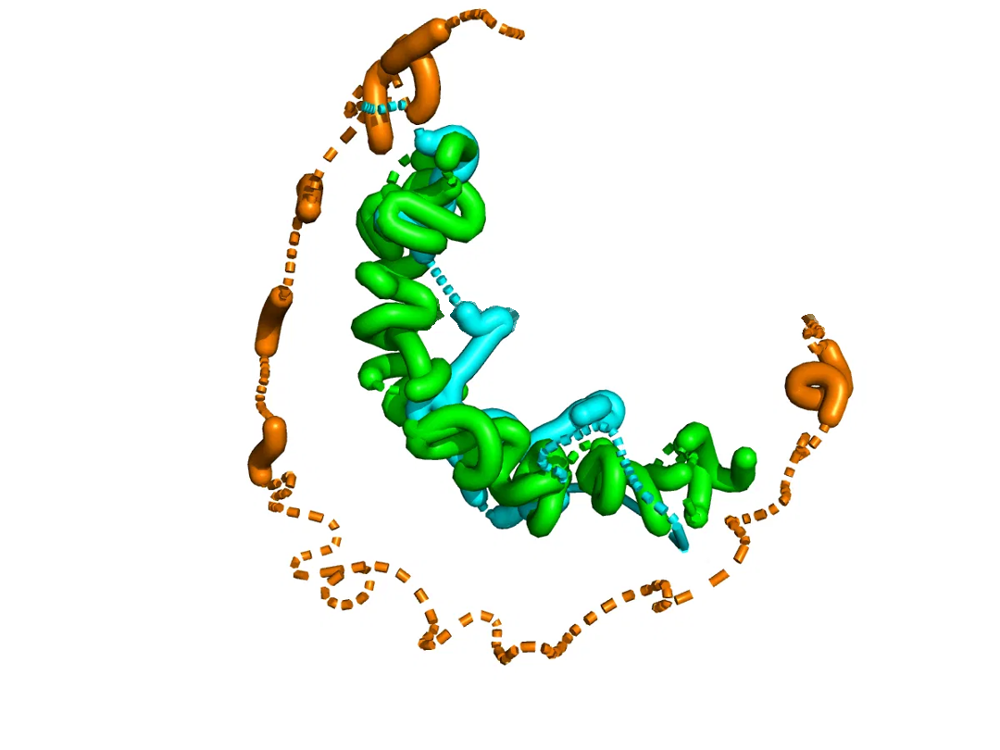
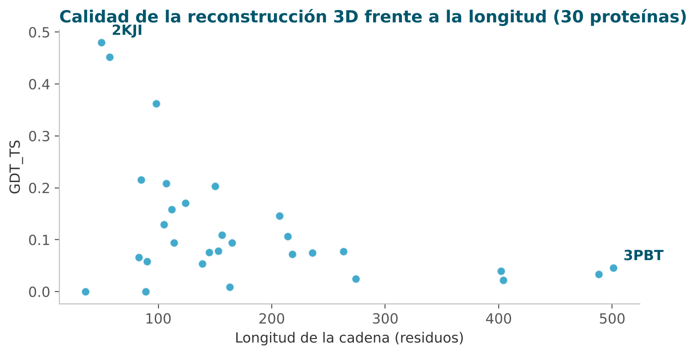
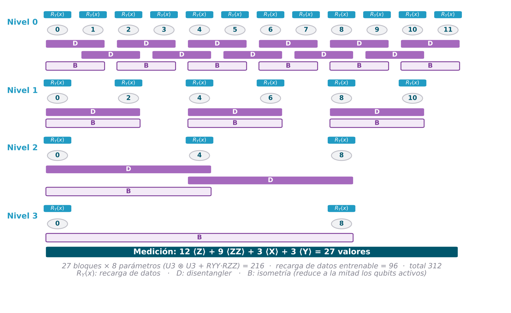

<div align="center">

# Red neuronal cuántica híbrida para la predicción de estructura de proteínas

**Predicción de contactos y estructura 3D a partir de la secuencia, combinando ESM-2 con un circuito cuántico MERA de 12 qubits**

Marco Antonio Roca Rodríguez · Director: Mariano Caruso
Trabajo Fin de Máster · Máster Universitario en Computación Cuántica · UNIR · 2026

[](https://www.python.org/)
[](https://pytorch.org/)
[](https://github.com/facebookresearch/esm)
[](docs/arquitectura.md#5-circuito-mera-bloque-7)
[](https://github.com/aqlaboratory/proteinnet)
[](LICENSE)

[**Memoria**](docs/Memoria.pdf) · [**Artículo**](docs/paper_TFM.pdf) · [**Presentación**](docs/presentacion_defensa.pdf) · [**Notebook**](notebook/TFM_QNN.ipynb) · [**Arquitectura**](docs/arquitectura.md) · [**Resultados**](results/)

<br>



</div>

---

## La pregunta

Las redes neuronales cuánticas híbridas se proponen a menudo para problemas de bioinformática, pero rara vez se comprueba **si la mejora viene de verdad de la parte cuántica**. Este trabajo construye un predictor completo, de la secuencia a la estructura 3D, y lo somete a una **ablación controlada**: el circuito cuántico se sustituye por una capa clásica con la misma forma y se compara todo lo demás en igualdad de condiciones.

## Resultados en tres cifras

<table>
<tr>
<td align="center" width="33%"><h2>+19,0 · +15,8 · +2,1</h2>puntos de P@L/5 sobre ESM-2<br>en corto, medio y largo alcance</td>
<td align="center" width="33%"><h2>≈ 0</h2>diferencia entre el circuito MERA<br>y una capa lineal equivalente</td>
<td align="center" width="33%"><h2>10,9 %</h2>P@L/5 de largo alcance,<br>sin alineamientos múltiples (MSA)</td>
</tr>
</table>

1. **El sistema funciona.** Supera a la predicción de contactos nativa de ESM-2 en los tres rangos del protocolo CASP, y P@L, P@L/5, MCC y Xd coinciden en ello.
2. **El circuito no es el que aporta.** Con el MERA o con una `Linear(12 → 27)` en su lugar, los resultados son indistinguibles en las dos réplicas (−0,0003 y −0,0071), y la diferencia favorece ligeramente a la capa lineal.
3. **El límite está en la entrada.** El largo alcance queda lejos del 27,0 % de CASP11, que usa MSA. Ni más datos ni otra arquitectura lo mueven. Además, el gradiente del circuito se apaga durante el entrenamiento, compatible con una meseta estéril.

<table>
<tr>
<td width="55%"></td>
<td width="45%"></td>
</tr>
<tr>
<td></td>
<td></td>
</tr>
</table>

<details>
<summary><b>Tablas completas</b></summary>

**Contactos** — 224 proteínas del conjunto de validación oficial de CASP11, rangos exclusivos, umbral de 8 Å (memoria, Tabla 5.1)

| Rango | Modelo | P@L | P@L/2 | P@L/5 | MCC | Xd |
|---|---|---:|---:|---:|---:|---:|
| Corto (6–11) | **Sistema propuesto** | 87,5 % | 88,5 % | **88,9 %** | 0,101 | 4,36 |
| | ESM-2 nativo | 69,7 % | 70,0 % | 69,9 % | 0,018 | 0,79 |
| | *Azar (densidad)* | | | *65,5 %* | | |
| Medio (12–23) | **Sistema propuesto** | 38,9 % | 39,8 % | **40,8 %** | 0,071 | 3,59 |
| | ESM-2 nativo | 25,0 % | 25,0 % | 25,0 % | 0,009 | 0,69 |
| | *Azar (densidad)* | | | *22,4 %* | | |
| Largo (≥ 24) | **Sistema propuesto** | 10,2 % | 10,7 % | **10,9 %** | 0,018 | 1,81 |
| | ESM-2 nativo | 8,6 % | 8,7 % | 8,9 % | 0,007 | 0,99 |
| | *Azar (densidad)* | | | *6,2 %* | | |

**Estructura 3D** — 30 proteínas (memoria, Tabla 5.2)

| Métrica | Media | Desv. típica | Mejor caso | Peor caso |
|---|---:|---:|---:|---:|
| RMSD (Å) | 14,24 | — | 3,55 | 33,90 |
| GDT_TS | 0,114 | 0,111 | 0,485 | 0,000 |
| TM-score | 0,222 | 0,094 | 0,425 | 0,003 |
| lDDT | 0,363 | — | 0,542 | 0,260 |

**Ablación** — P@L/5 de largo alcance (memoria, Tabla 5.4)

| Réplica | Circuito MERA (312 parám.) | Capa lineal (351 parám.) | Diferencia | TM-score MERA / lineal |
|---|---:|---:|---:|---:|
| 1 · `training_30` | 0,1047 | 0,1050 | −0,0003 | 0,227 / 0,232 |
| 2 · `training_100` | 0,0980 | 0,1051 | −0,0071 | 0,229 / 0,223 |

Los valores por proteína, el historial de entrenamiento y las métricas completas de la ejecución guardada (réplica 2) están en [`results/`](results/).

</details>

## Reconstrucción 3D

<table>
<tr>
<td width="45%" align="center"><br><sub><b>2KJI</b> (50 residuos): real en <b>cian</b>, MDS en <b>naranja</b>, refinada en <b>verde</b></sub></td>
<td width="55%"></td>
</tr>
</table>

El modelo predice distancias, no coordenadas. La estructura se obtiene en tres pasos: un mapa de distancias por valor esperado, un escalado multidimensional (MDS) y un refinamiento que fija 3,8 Å entre Cα consecutivos. En cadenas cortas funciona bien. En cadenas largas, la MDS tiene que cuadrar a la vez un número de distancias que crece con $L^2$, y los errores se acumulan.

## Cómo funciona

<div align="center"></div>

| Etapa | Qué hace |
|---|---|
| **ESM-2 (35M), congelado** | Embeddings de la capa 6 ($L \times 480$) y 240 mapas de atención (12 capas × 20 cabezas) |
| **Vector de par (1201)** | $e_i + e_j$, $\lvert e_i - e_j\rvert$, separación $(j-i)/L$ y la atención simetrizada del par |
| **Embudo MLP** | 1201 → 32 → 12 ángulos en $[-\pi, \pi]$, uno por qubit (codificación angular) |
| **Circuito MERA** | 12 qubits, 4 niveles, 27 bloques ($U_3 \otimes U_3$ + $R_{YY}R_{ZZ}$), recarga de datos en cada nivel. Se miden 27 valores esperados ($12\langle Z\rangle + 9\langle ZZ\rangle + 3\langle X\rangle + 3\langle Y\rangle$). Se simula como vector de estado en PyTorch |
| **Capas clásicas** | 39 → 64 → 32 → distancia (5 intervalos) y 2 ángulos de orientación (12 intervalos), en aprendizaje multitarea |
| **Reconstrucción** | Mapa de distancias → MDS → refinamiento en dos fases → métricas CASP |

**45 103 parámetros** en total: 38 924 en el embudo y **312 en el circuito**. La descripción completa, con fórmulas y recuentos, está en [`docs/arquitectura.md`](docs/arquitectura.md).

## Estructura del repositorio

```text
qnn-protein_structure-prediction/
├── notebook/
│   └── TFM_QNN.ipynb              # todo el pipeline, en 8 partes y 19 bloques documentados
├── results/
│   ├── resultados_tfm.json         # resumen completo, con la fuente de cada cifra
│   ├── metricas_contactos.csv      # métricas de contacto por modelo y rango
│   ├── estructura_3d_por_proteina.csv
│   ├── historial_entrenamiento.csv
│   └── pymol/                      # figura 3D y script de PyMOL
├── docs/
│   ├── Memoria.pdf                 # memoria del TFM
│   ├── paper_TFM.pdf               # artículo derivado (inglés)
│   ├── presentacion_defensa.pdf    # diapositivas de la defensa
│   ├── arquitectura.md             # descripción técnica detallada
│   └── figures/                    # figuras de este README
├── scripts/
│   ├── extraer_resultados.py       # notebook + memoria → results/
│   └── generar_figuras.py          # results/ → docs/figures/
├── experiments/                    # pruebas exploratorias descartadas
├── requirements.txt                # dependencias directas
├── requirements-lock.txt           # entorno exacto de la ejecución guardada
├── CITATION.cff
└── LICENSE
```

## Puesta en marcha

**1. Entorno**

```bash
python -m venv .venv
source .venv/bin/activate            # Windows: .venv\Scripts\activate
pip install --upgrade pip
# PyTorch con la build adecuada para tu GPU: https://pytorch.org/get-started/locally/
pip install -r requirements.txt
```

Los pesos de ESM-2 se descargan solos la primera vez. Se recomienda una GPU NVIDIA: la ejecución guardada se hizo con una RTX 5070 Ti.

**2. Datos.** Descarga [ProteinNet CASP11](https://github.com/aqlaboratory/proteinnet) y deja los ficheros de texto en `casp11/`, en la raíz del repositorio. La carpeta está en `.gitignore`.

```text
casp11/
├── training_100
└── validation
```

**3. Ejecución.** Abre `notebook/TFM_QNN.ipynb` y ejecuta las celdas en orden. Haz primero una prueba rápida con `RUN_MODE = "smoke"` en el Bloque 2: recorre el pipeline completo en un par de minutos. Después pon `RUN_MODE = "full"`.

| Parámetro (Bloque 2) | Valor | |
|---|---|---|
| `TRAINING_SET` | `training_100` | subconjunto de ProteinNet |
| `MAX_PROTEINS_TRAIN` | 5 000 | proteínas muestreadas |
| `MAX_PER_BIN` | 20 000 | pares por intervalo de distancia y partición |
| `LR_CLASSICAL` / `LR_QUANTUM` | 10⁻³ / 0,02 | AdamW, con calentamiento del circuito |
| `USE_QUANTUM` | `True` | `False` cambia el circuito por la capa lineal |

**4. Resultados y figuras.** La Parte VII del notebook reconstruye las tablas a partir del registro que escriben las Partes V y VI. Para regenerar `results/` y las figuras desde las salidas guardadas:

```bash
python scripts/extraer_resultados.py
python scripts/generar_figuras.py
```

## Limitaciones

- El circuito se **simula sin ruido** y con valores esperados exactos. En hardware real cada observable exigiría muchas ejecuciones.
- La codificación angular limita la entrada del circuito a 12 valores. La compresión desde 1201 dimensiones es uno de los cuellos de botella.
- Solo se ha comparado un ansatz (MERA) en la ablación, y ESM-2 es la versión pequeña (35M).
- La comparación con CASP es orientativa: CASP evalúa dominios de modelado libre con métodos que usan MSA, y aquí se evalúan todas las proteínas con una sola secuencia.

## Trabajo futuro

- **Codificación en amplitud:** cargar el par entero en las 4096 amplitudes de 12 qubits, sin comprimirlo antes.
- **Barrido del número de qubits** (4, 8, 12, 16) y **ablación con los otros ansätze** (VQC y TTN).
- **Medir el entrelazamiento** del circuito entrenado y probar estrategias contra las mesetas estériles.
- **Lectura del estado con *classical shadows*** y **ejecución en hardware real** con mitigación de errores.
- **Lado clásico:** ESM-2 más grande (650M / 3B), información de MSA y mejor reconstrucción en cadenas largas.

## Cita

```bibtex
@mastersthesis{roca2026qnnprotein,
  author = {Roca Rodríguez, Marco Antonio},
  title  = {Red neuronal cuántica híbrida para la predicción de estructura tridimensional
            de proteínas mediante embeddings de lenguaje proteico},
  school = {Universidad Internacional de La Rioja (UNIR)},
  type   = {Trabajo Fin de Máster, Máster Universitario en Computación Cuántica},
  year   = {2026},
  url    = {https://github.com/marrocrod/qnn-protein_structure-prediction}
}
```

## Licencia y agradecimientos

El código se distribuye bajo licencia [MIT](LICENSE). La licencia cubre el código propio y no sustituye las condiciones de uso de ProteinNet, ESM-2 ni de las demás dependencias.

Gracias a **Mariano Caruso** por dirigir este trabajo.
