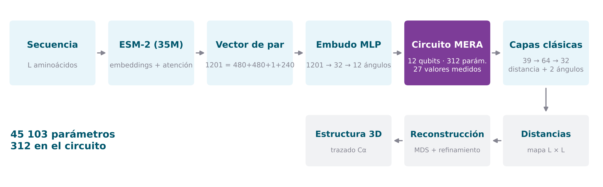
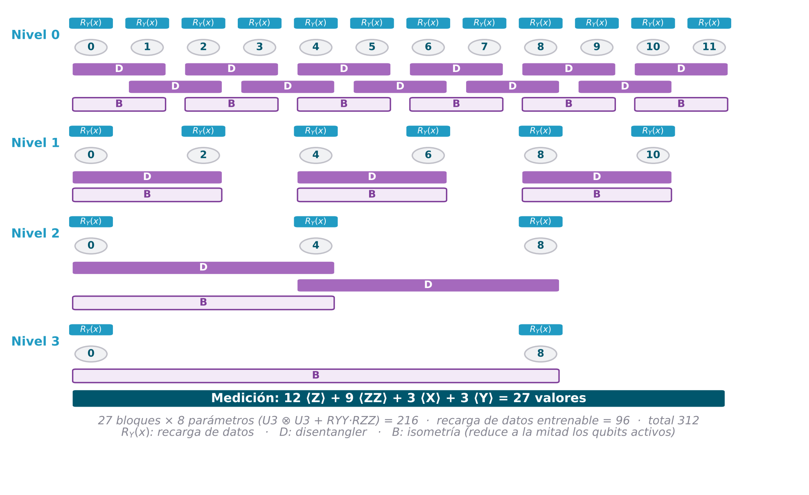

# Arquitectura y metodología

Descripción técnica completa del sistema **tal y como está implementado** en [`notebook/TFM_QNN.ipynb`](../notebook/TFM_QNN.ipynb). Cada sección indica el bloque del notebook donde vive el código.

<p align="center"></p>

---

## 1. Problema

A partir de la secuencia de aminoácidos de una proteína, predecir la distancia entre cada par de carbonos alfa (Cα) y, con ese mapa de distancias, reconstruir su estructura tridimensional. El modelo no usa alineamientos múltiples (MSA): trabaja con **una sola secuencia**.

## 2. Datos (Bloques 4–6)

| Elemento | Detalle |
|---|---|
| Fuente | [ProteinNet](https://github.com/aqlaboratory/proteinnet) CASP11 |
| Entrenamiento | `training_100` (87 573 proteínas); se muestrean al azar 5 000 con *reservoir sampling* |
| Partición | 80 % entrenamiento / 20 % monitorización, **por proteína completa** (sin fuga entre pares de una misma proteína) |
| Evaluación | conjunto `validation` oficial de CASP11: 224 proteínas para contactos, las 30 primeras para 3D; nunca se usa al entrenar |
| Pares | $\lvert i-j \rvert \ge 6$; se guardan como máximo 20 000 pares por intervalo de distancia en cada partición (100 000 + 100 000) |
| Coordenadas | ProteinNet guarda picómetros; se dividen entre 100 para trabajar en Å |

### Etiquetas (Bloque 5)

- **Distancia** Cα–Cα en 5 intervalos: $[0,4)$, $[4,8)$, $[8,12)$, $[12,16)$ y $\ge 16$ Å. Los dos primeros juntos definen el contacto (< 8 Å).
- **Ángulo $a$**: entre la dirección de la cadena en $i$ (tangente $t_i \propto x_{i+1}-x_{i-1}$) y el vector $i \to j$.
- **Ángulo $b$**: lo mismo desde $j$ hacia $i$.
- Ambos ángulos en 12 intervalos de 15° sobre $[0°, 180°]$. Solo necesitan los Cα.

## 3. Representación de cada par (Bloques 3 y 6)

[ESM-2 t12 35M](https://github.com/facebookresearch/esm) congelado (12 capas, 20 cabezas). De cada proteína se toman los embeddings de la **capa 6** ($L \times 480$; las capas intermedias codifican mejor la estructura que la última) y los 240 mapas de atención (12 capas × 20 cabezas), **simetrizados**.

| Parte | Dim. |
|---|---|
| $e_i + e_j$ | 480 |
| $\lvert e_i - e_j \rvert$ | 480 |
| $(j-i)/L$ | 1 |
| atención $\tfrac12(a_{ij}+a_{ji})$ en las 240 cabezas | 240 |
| **Total** | **1201** |

El vector es **simétrico**: $(i,j)$ y $(j,i)$ dan lo mismo. La probabilidad de contacto nativa de ESM-2 **no** se usa como entrada (`USE_CONTACT = False`): se reserva como referencia independiente en la evaluación. Las características se estandarizan con un `StandardScaler` ajustado solo con los pares de entrenamiento.

## 4. Modelo híbrido (Bloques 7–8)

```
x (1201) → Linear 1201→32 → LayerNorm → GELU → Dropout(0,5) → Linear 32→12 → LayerNorm → tanh·π → θ ∈ [−π, π]^12
θ → MERA (o Linear 12→27) → BatchNorm(27) → concat[ ·, θ/π ] (39) → Linear 64 → BN → ReLU → Dropout
  → Linear 32 → BN → ReLU → Dropout → { distancia (5) · ángulo a (12) · ángulo b (12) }
```

| Componente | Parámetros |
|---|---:|
| Embudo MLP (1201 → 32 → 12, con normalizaciones) | 38 924 |
| Circuito MERA | 312 |
| Normalizaciones, capas clásicas y cabezas | 5 867 |
| **Total** | **45 103** |

Con la capa lineal en lugar del circuito (ablación): 351 parámetros en la ruta y 45 142 en total.

**Por qué un embudo tan estrecho.** Con codificación angular, cada qubit recibe un valor, así que hay que pasar de 1201 a 12. Un MLP más ancho memorizaba la firma ESM de las proteínas de entrenamiento en lugar de generalizar. El embudo se entrena junto con el circuito, de modo que aprende qué 12 combinaciones del par sirven a la tarea.

**Conexión residual.** Los 12 ángulos llegan también a las capas clásicas, además de las 27 medidas del circuito.

## 5. Circuito MERA (Bloque 7)

<p align="center"></p>

### Simulación

Vector de estado de $2^{12} = 4096$ amplitudes complejas (`complex64`) por muestra, simulado **directamente en PyTorch** y por lotes en GPU. Las puertas de uno y dos qubits se aplican como productos de matrices por lote, y el gradiente se obtiene con autograd. Las primeras versiones usaban PennyLane, que simulaba par a par y tardaba en torno a media hora por época.

### Estructura

| Nivel | Qubits | Recarga $R_Y$ | Disentanglers | Isometrías | Bloques |
|---|---|---|---|---|---:|
| 0 | 12 → 6 | 0–11 | (0,1) (2,3) … (10,11) y fronteras (1,2) (3,4) … (9,10) | (0,1) (2,3) … (10,11) | 17 |
| 1 | 6 → 3 | 0, 2, 4, 6, 8, 10 | (0,2) (4,6) (8,10) | (0,2) (4,6) (8,10) | 6 |
| 2 | 3 → 2 | 0, 4, 8 | (0,4) (4,8) | (0,4) | 3 |
| 3 | 2 → 1 | 0, 8 | — | (0,8) | 1 |
| | | | | **Total** | **27** |

En cada nivel se aplican, en este orden, la recarga de datos, los disentanglers y las isometrías.

### Bloque de dos qubits (8 parámetros)

$$B(\boldsymbol\theta) = R_{YY}(\varphi)\,R_{ZZ}(\vartheta)\;\big[U_3(\alpha_1,\beta_1,\gamma_1)\otimes U_3(\alpha_2,\beta_2,\gamma_2)\big],\qquad U_3(\alpha,\beta,\gamma) = R_Z(\gamma)R_Y(\beta)R_Z(\alpha)$$

Disentanglers e isometrías usan la misma forma; lo que cambia es sobre qué qubits actúan. Los pesos se inicializan en $\mathcal U(-0{,}05;\ 0{,}05)$, cerca de la identidad, para reducir el riesgo de mesetas estériles.

### Recarga de datos

Al empezar el nivel $\ell$, el $k$-ésimo qubit activo recibe $R_Y\!\left(s_{\ell k}\,\theta_k + b_{\ell k}\right)$, con escala $s$ y sesgo $b$ entrenables (inicializados en ≈1 y ≈0). Repetir la codificación amplía el espectro de frecuencias que el circuito puede representar (Pérez-Salinas *et al.*, 2020; Schuld *et al.*, 2021). En los niveles 1–3, los qubits activos reciben los primeros valores de entrada ($\theta_0, \theta_1, \dots$).

### Medición (27 valores)

| Observable | Qubits | Nº |
|---|---|---:|
| $\langle Z_q\rangle$ | 0 – 11 | 12 |
| $\langle Z_a Z_b\rangle$ | (0,1) (2,3) (4,5) (6,7) (8,9) (10,11) (0,4) (4,8) (0,8) | 9 |
| $\langle X_q\rangle$ | 0, 4, 8 | 3 |
| $\langle Y_q\rangle$ | 0, 4, 8 | 3 |

Los observables diagonales se calculan con las probabilidades $|\psi|^2$; $\langle X\rangle$ y $\langle Y\rangle$, con la coherencia entre amplitudes que difieren en el bit del qubit. Son valores esperados exactos (sin muestreo de disparos).

### Recuento de parámetros

| Concepto | Cálculo | Parámetros |
|---|---|---:|
| Bloques | 27 × 8 | 216 |
| Recarga de datos | 2 (escala, sesgo) × 4 niveles × 12 qubits | 96 |
| **Total** | | **312** |

En los niveles 1, 2 y 3 solo hay 6, 3 y 2 qubits activos, así que de los 96 parámetros de recarga intervienen 46 (12 + 6 + 3 + 2 por tensor). Los 50 restantes se reservan pero nunca reciben gradiente.

## 6. Entrenamiento (Bloques 9–10)

| Elemento | Valor |
|---|---|
| Pérdida | $\mathcal L = \mathrm{CE}_{dist} + 0{,}3\,\mathrm{CE}_a + 0{,}3\,\mathrm{CE}_b$ (entropía cruzada) |
| Optimizador | AdamW con tres grupos: ruta intercambiable (LR 0,02, sin *weight decay*), pesos clásicos (LR 10⁻³, *weight decay* 10⁻²), sesgos y normalizaciones (LR 10⁻³) |
| Calentamiento | LR del circuito de 0 a 0,02 linealmente durante 3 épocas |
| Planificador | `ReduceLROnPlateau` (×0,5 tras 5 épocas sin mejora) |
| Regularización | dropout 0,5 · recorte del gradiente a norma 1 |
| Parada | temprana con paciencia 10 sobre la pérdida de monitorización; batch 64; máx. 120 épocas |
| Diagnóstico | norma media del gradiente de la ruta cuántica por época, medida antes del recorte |

## 7. Evaluación (Bloques 11–15)

### Contactos (protocolo CASP)

Rangos **exclusivos** de separación (corto 6–11, medio 12–23, largo ≥ 24). Para cada proteína y rango se ordenan los pares por la probabilidad predicha de contacto, $P(d<8\,\text{Å}) = p_0 + p_1$, y se evalúan los $K \in \{L, L/2, L/5, L/10\}$ primeros:

- **P@K**: fracción de contactos reales entre los $K$ pares. La métrica de CASP es P@L/5 en largo alcance.
- R@K y F1@K: *recall* y F1 de la misma lista.
- **MCC**: coeficiente de Matthews de la lista $L/5$.
- **Xd**: $\sum_k (P_k - A_k)/d_k$, con $P$ y $A$ las distribuciones (en %) de distancias de los pares predichos y de todos los pares del rango, en 10 intervalos de 4 Å de centro $d_k$. 0 equivale al azar.
- AUC-PR: área bajo la curva precisión-*recall*.
- Densidad: fracción de pares en contacto; es lo que acierta un predictor aleatorio.

La referencia es la **predicción de contactos nativa de ESM-2**, sin nada entrenado en este trabajo.

### Estructura 3D

1. **Mapa de distancias** por valor esperado, $\hat d_{ij} = \sum_k p_k c_k$, con centros 2, 6, 10, 14 y 20 Å.
2. **MDS métrico** (scikit-learn, 4 reinicios, 300 iteraciones), escalando por la mediana.
3. **Refinamiento** en dos fases por descenso de gradiente, con desplazamiento máximo de 0,5 Å por átomo y paso:
   - fase 1 (400 pasos): pares con separación ≥ 6 y distancia < 20 Å, más la cadena con peso bajo;
   - fase 2 (200 pasos): todos los pares < 8 Å y la cadena a 3,8 Å con peso alto.
4. **Métricas** tras la superposición de Kabsch: RMSD, GDT_TS (1/2/4/8 Å), GDT_HA (0,5/1/2/4 Å), TM-score y lDDT (radio 15 Å, sin superposición).

## 8. Ablación (Bloque 16)

Dos brazos idénticos salvo la ruta intercambiable:

- **MERA**: 312 parámetros.
- **`Linear(12 → 27)`**: 351 parámetros.

Los dos brazos usan los mismos datos, la misma semilla, los mismos hiperparámetros y la misma parada temprana, y se entrenan dentro de una única ejecución. El circuito se reinicializa antes de su brazo. Se repitió en dos réplicas: `training_30` (diferencia de −0,0003 en P@L/5 de largo alcance) y `training_100` (−0,0071, que es la ejecución guardada en el notebook). En las dos réplicas la diferencia favorece a la capa lineal y está dentro del ruido experimental.

## 9. Evolución del diseño

| Paso | Cambio | Motivo |
|---|---|---|
| Ansatz | VQC genérico → TTN (árbol, 28 parámetros, 2 valores medidos) → MERA | el VQC sufría mesetas estériles y no tenía sesgo útil; el TTN aislaba las ramas del árbol; el MERA las conecta con disentanglers |
| Medición | de $\langle Z_0\rangle, \langle Z_4\rangle$ a 27 observables | más información del mismo estado sin añadir parámetros |
| Simulación | PennyLane par a par → vector de estado por lotes en PyTorch | de unos 30 minutos por época a minutos, lo que permitió usar muchos más pares |
| Entrada | embeddings → embeddings simétricos + atención por par (1201) | la atención de ESM-2 ya señala pares en contacto |
| Datos | de ~1 200 a miles de proteínas | eliminar el sobreajuste |
| Evaluación | rangos acumulados → protocolo CASP con rangos exclusivos y referencia ESM-2 | las cifras con rangos acumulados estaban infladas por el corto alcance |

## 10. Limitaciones conocidas

- El circuito se **simula sin ruido**, con valores esperados exactos. En hardware real cada observable requiere muchas ejecuciones.
- La codificación angular limita la entrada del circuito a 12 valores. Esa compresión desde 1201 es uno de los cuellos de botella.
- La norma del gradiente del circuito cae durante el entrenamiento: de 0,22 a ~0,02 en la ejecución guardada. Es compatible con una meseta estéril.
- Solo se ha comparado un ansatz (MERA) en la ablación.
- La comparación con CASP es orientativa: CASP evalúa dominios de modelado libre con métodos que usan MSA.
- El trazado es solo de Cα: no hay cadenas laterales ni el resto del esqueleto.
