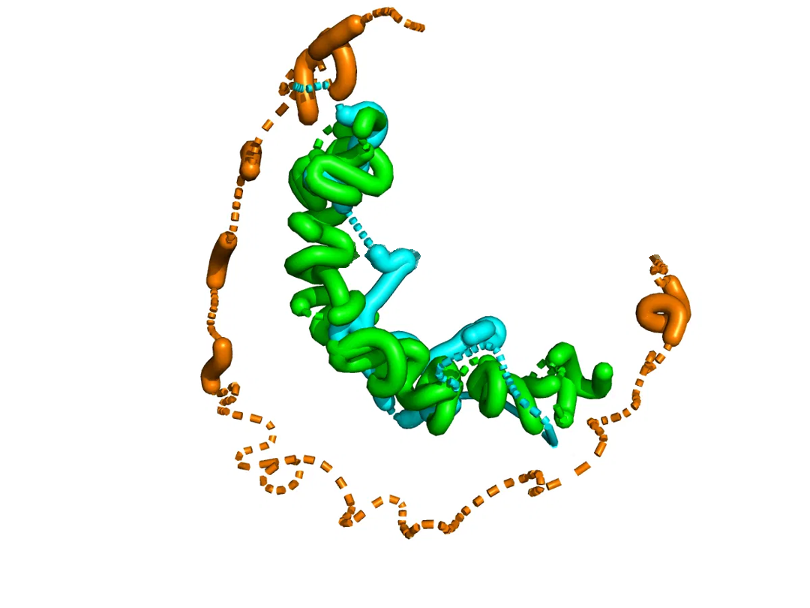

# Figura de PyMOL

<p align="center"></p>

Reconstrucción de **2KJI** (50 residuos), el mejor caso del conjunto de evaluación en la memoria (GDT_TS 0,485). Cada estructura tiene un color:

| Color | Estructura |
|---|---|
| Cian | experimental (referencia) |
| Naranja | reconstrucción directa por MDS |
| Verde | reconstrucción tras el refinamiento en dos fases |

Todas son trazados de solo Cα, superpuestos con Kabsch sobre la estructura real.

## Cómo generarla

1. Ejecuta el Bloque 18 del notebook. Escribe en `results/pymol/pdb/` tres PDB por proteína: `<id>_real.pdb` (cadena A), `<id>_mds.pdb` (B) y `<id>_refined.pdb` (C). Por defecto exporta las 5 primeras proteínas de validación; 2KJI es la 14.ª, así que para esta figura sube `N_PROTEINAS_EXPORT` a 14.
2. El Bloque 19 escribe junto a ellos un `<id>_figura.pml` con la escena. Para otra proteína puedes usar [`render_figura.pml`](render_figura.pml) cambiando el identificador.
3. Ábrelo con PyMOL:

   ```bash
   conda install -c conda-forge pymol-open-source   # versión libre, sin marca de agua
   cd results/pymol/pdb
   pymol <id>_figura.pml
   ```

El script deja la escena con fondo blanco y guarda `<id>_figura.png` a 2400 × 1800 px. Los identificadores de ProteinNet llevan `#` (por ejemplo `20#2KJI_1_A`), que en PyMOL inicia un comentario; por eso los scripts cargan los ficheros desde un bloque `python`.

Los PDB no se versionan, porque se regeneran con el notebook. Las estructuras experimentales proceden de ProteinNet / PDB; las reconstrucciones son salidas del modelo.
